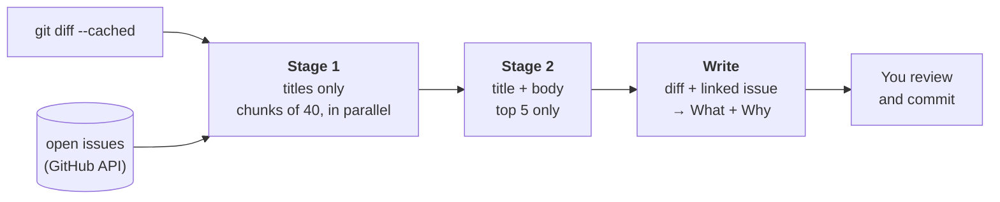

<div align="center">

# CMG-Skills

**Commit messages that say *why*, not just *what*.**

An agent skill that finds the open issue your staged change fixes,
then writes the commit message from it.

[](https://skills.sh/Anonymous-Authors-CMG/CMG-Skills)
[](LICENSE)


English · [简体中文](README.zh-CN.md)

</div>

---

## The problem

Ask any LLM for a commit message and you get a tidy summary of the diff:

```
fix: update text_to_word_sequence to use dict-based maketrans
```

Correct, and useless six months later. Nobody reading `git log` can tell what
broke, who hit it, or why this fix was chosen. That information is sitting in
the issue tracker, in an issue the developer never bothered to link.

This skill goes and gets it:

```
fix: support multi-character split in text_to_word_sequence

Tokenizer can be configured with a multi-character split string, but
text_to_word_sequence called maketrans with split * len(filters),
which only works when split is one character. For split="any",
Python raised "the first two maketrans arguments must have equal
length" during fit_on_texts.

Replace each filter character with the full split string using a
translation dictionary on Python 3. Keep Python 2 compatibility by
using the existing single-character path when possible and falling
back to repeated replace for multi-character splits.

Fixes #9538
```

The second message came from a real run against the 60 issues that were open
when that keras fix landed. The skill picked #9538 out of them on its own.

## How it works

Reading every open issue would blow up the context. So it reads the way a
person skims a tracker: titles first, then only the few that look right.



A repository with 120 open issues costs about 5 short LLM calls. Only five
issue bodies are ever read in full.

## Does it help?

From the paper, 1,200 commit-issue pairs across six repositories (PyTorch,
Keras, DeepSpeed, ClickHouse, Pulsar, RocketMQ), scored 0-4:

| | What | Why |
|---|:---:|:---:|
| Diff only | 3.780 | **2.547** |
| Diff + the linked issue | 3.918 | **3.931** |

LLMs already describe *what* changed well. The gap is *why*, and the issue is
what closes it. The retrieval puts the correct issue first about 9 times in 10
(Hit@1 0.890, MRR 0.913). Full numbers: [`references/results.md`](skills/commit-message-from-issue/references/results.md).

---

## Install

Pick one. All of them install the same folder,
[`skills/commit-message-from-issue`](skills/commit-message-from-issue).

### Option 1 · `npx skills` (any agent)

Works with Claude Code, Codex, Cursor, Gemini CLI, GitHub Copilot, OpenCode and
[dozens more](https://skills.sh). It detects which agents you have and puts the
skill in the right place for each.

```bash
npx skills add Anonymous-Authors-CMG/CMG-Skills          # current project
npx skills add Anonymous-Authors-CMG/CMG-Skills -g       # all projects
npx skills add Anonymous-Authors-CMG/CMG-Skills -g -a claude-code -a codex
```

### Option 2 · Claude Code plugin marketplace

Inside Claude Code:

```
/plugin marketplace add Anonymous-Authors-CMG/CMG-Skills
/plugin install commit-message-from-issue@cmg-skills
```

Or from a shell:

```bash
claude plugin marketplace add Anonymous-Authors-CMG/CMG-Skills
claude plugin install commit-message-from-issue@cmg-skills
```

Update later with `claude plugin update commit-message-from-issue@cmg-skills`.

### Option 3 · Copy it by hand

```bash
git clone https://github.com/Anonymous-Authors-CMG/CMG-Skills.git
cp -r CMG-Skills/skills/commit-message-from-issue ~/.claude/skills/   # Claude Code
cp -r CMG-Skills/skills/commit-message-from-issue ~/.codex/skills/    # Codex
```

## Use

Stage your change, then ask your agent in plain words:

```
> I staged the fix. Write my commit message.
```

The agent runs the pipeline, shows you which issue it linked and the message,
and stops. **It does not commit for you.** Check the linked issue; about one
time in ten it will be a near miss.

Nothing staged yet and just want to see it work? Try the offline demo, which
needs no GitHub access:

```bash
bash skills/commit-message-from-issue/examples/run_example.sh
```

---

## Choosing the model

The skill needs an LLM to call. **You usually don't have to configure
anything.** It picks the first match in this order:

| | When | It uses |
|:---:|---|---|
| 1 | `CM_LLM_CMD` is set | that CLI |
| 2 | `CM_API_KEY` is set | an OpenAI-compatible API |
| 3 | it is running inside Claude Code, Codex, Gemini CLI, CodeBuddy | the same agent, e.g. `claude -p` inside Claude Code |
| 4 | `OPENAI_API_KEY` and a model name are set | the OpenAI API |
| 5 | none of the above | the first of `claude` `codex` `gemini` `codebuddy` `cursor-agent` `opencode` found on `PATH` |

See what it picked, and that it answers:

```bash
python3 skills/commit-message-from-issue/scripts/pdil.py --check
```

### Use an agent CLI you are logged in to

```bash
export CM_LLM_CMD=claude          # claude -p <prompt>
export CM_LLM_CMD=codex           # codex exec --skip-git-repo-check <prompt>
export CM_LLM_CMD=gemini          # gemini -p <prompt>
export CM_LLM_CMD=codebuddy       # codebuddy -p <prompt>
export CM_LLM_CMD=cursor-agent    # cursor-agent -p --output-format text <prompt>
export CM_LLM_CMD=opencode        # opencode run <prompt>
export CM_LLM_MODEL=...           # optional, passed as --model
```

Any other command is called as `<cmd> -p <prompt>`.

### Use an API directly (fastest)

Anything that speaks OpenAI's `/chat/completions`: OpenAI, DeepSeek, Qwen,
Kimi, OpenRouter, a local vLLM or Ollama server.

```bash
export CM_API_KEY=sk-...
export CM_BASE_URL=https://api.deepseek.com      # default: https://api.openai.com/v1
export CM_LLM_MODEL=deepseek-chat
```

```bash
# a local model, no key needed
export CM_API_KEY=local CM_BASE_URL=http://localhost:11434/v1 CM_LLM_MODEL=qwen3:32b
```

There's a template in [`.env.example`](.env.example).

### GitHub access

Open issues come from the GitHub API. Without a token you get 60 requests an
hour, enough for a few runs. Set one to get 5,000:

```bash
export GITHUB_TOKEN=ghp_...    # or GH_TOKEN; read-only public access is enough
```

### All settings

| Variable | Default | |
|---|---|---|
| `CM_LLM_CMD` | auto | Agent CLI to call |
| `CM_API_KEY` | – | Key for an OpenAI-compatible API |
| `CM_BASE_URL` | `https://api.openai.com/v1` | API base URL |
| `CM_LLM_MODEL` | backend default | Model name |
| `GITHUB_TOKEN` | – | Raises the GitHub limit to 5,000 req/h |
| `CM_PARALLEL` | `4` | Stage-1 chunks run at once |
| `CM_LLM_TIMEOUT` | `600` | Seconds per LLM call |
| `CM_LLM_RETRIES` | `2` | Retries per failed call |
| `CM_MAX_DIFF_CHARS` | `12000` | Longer diffs keep the first 70 % and last 30 % |

---

## Without an agent

The scripts are plain Python 3.9+, standard library only. Run them from your
repository root:

```bash
SKILL=path/to/skills/commit-message-from-issue

python3 $SKILL/scripts/link_and_write.py --out run.json --message-out msg.txt
git diff --cached > staged.diff
python3 $SKILL/scripts/score_message.py --diff-file staged.diff --message-file msg.txt

git commit -F msg.txt     # after you've read it
```

| Flag | Default | Raise it when |
|---|:---:|---|
| `--repo owner/name` | from `origin` | `origin` isn't the GitHub repo with the issues |
| `--pool-size` | 120 | the fix is for an older issue |
| `--top-n` | 5 | several titles look plausible |
| `--chunk-size` | 40 | lower it if Stage 1 keeps missing the right issue |

## On every pull request

The same method as a GitHub Action or GitLab CI job. When a PR opens, it posts
one comment: the open issue the PR seems to address, with the evidence, and a
squash commit message that explains why. It edits nothing and says so when no
issue matches.

```yaml
# .github/workflows/issue-commit.yml
on:
  pull_request:
    types: [opened, ready_for_review, reopened]
permissions: { contents: read, issues: read, pull-requests: write }
jobs:
  suggest:
    runs-on: ubuntu-latest
    steps:
      - uses: Anonymous-Authors-CMG/CMG-Skills@v1
        with:
          api-key: ${{ secrets.CMG_API_KEY }}
          model: ${{ secrets.CMG_MODEL }}
```

```yaml
# .gitlab-ci.yml
include:
  - remote: https://raw.githubusercontent.com/Anonymous-Authors-CMG/CMG-Skills/v1/ci/gitlab-ci.yml
```

On five real PRs and MRs from keras and gitlab-org/cli it found the right
issue four times and correctly said "no match" for the fifth.
Setup, inputs, fork PRs and cost: **[docs/ci.md](docs/ci.md)**.

## What leaves your machine

- **The staged diff and issue text** go to whichever model backend you picked.
- **GitHub API** (`api.github.com`) is queried for open issues of the repo.
- Nothing else. The scripts don't commit, push, or edit files.

Read [`scripts/pdil.py`](skills/commit-message-from-issue/scripts/pdil.py)
before installing if you want to check. It is about 400 lines.

## Limits

- **GitHub and GitLab only.** The local skill reads GitHub issues; the CI bot
  handles GitHub and GitLab. Jira and others aren't wired up yet.
- **It can be wrong.** About one link in ten misses. In the paper, even misses
  usually landed on a closely related issue and still helped the Why, but you
  should look before you commit.
- **Some changes have no issue.** Then you get a message without a `Fixes` line
  and a note that the Why came from the diff alone. That's on purpose.
- **It takes 20-80 seconds.** That's five LLM calls. The direct API backend is
  the quickest.

## Repository layout

```
CMG-Skills/
├── .claude-plugin/marketplace.json     Claude Code marketplace
├── action.yml                          GitHub Action
├── ci/gitlab-ci.yml                    GitLab CI template
├── docs/ci.md                          PR / MR bot guide
└── skills/commit-message-from-issue/
    ├── SKILL.md                        what the agent reads
    ├── .claude-plugin/plugin.json
    ├── prompts/                        Stage 1, Stage 2, writer, judge
    ├── scripts/                        pipeline, PR/MR bot, scorer, demo builders
    ├── examples/                       keras-9585 (offline), keras-23710 (live)
    └── references/                     paper numbers, verified runs
```

## Citation

This repository accompanies a paper currently under double-blind review:

```bibtex
@article{reasonmatters2026,
  title   = {Reason Matters: Enhancing the Rationale of Generated Commit
             Messages via Issue-Driven Skills},
  author  = {Anonymous Authors},
  journal = {Under review},
  year    = {2026}
}
```

## License

[MIT](LICENSE)
