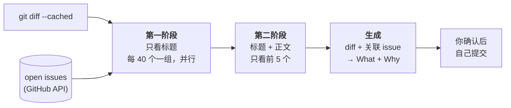

<div align="center">

# CMG-Skills

**让提交信息写清楚「为什么改」，而不只是「改了什么」。**

一个 Agent Skill：先找到你这次改动要修的那个 open issue，再根据它写提交信息。

[](https://skills.sh/Anonymous-Authors-CMG/CMG-Skills)
[](LICENSE)


[English](README.md) · 简体中文

</div>

---

## 问题在哪

让大模型写提交信息，通常会得到一句很整齐的 diff 摘要：

```
fix: update text_to_word_sequence to use dict-based maketrans
```

没写错。但半年后有人翻 `git log`，还是不知道当时什么东西坏了、谁遇到的、为什么这么修。

这些信息其实都在 issue 里，只是提交的人没去关联。

这个 skill 会去把它找出来：

```
fix: support multi-character split in text_to_word_sequence

Tokenizer can be configured with a multi-character split string, but
text_to_word_sequence called maketrans with split * len(filters),
which only works when split is one character. For split="any",
Python raised "the first two maketrans arguments must have equal
length" during fit_on_texts.

Replace each filter character with the full split string using a
translation dictionary on Python 3. Keep Python 2 compatibility by
using the existing single-character path when possible and falling
back to repeated replace for multi-character splits.

Fixes #9538
```

上面这条是真实跑出来的。输入是 keras 那次修复的 diff，加上当时还开着的 60 个 issue，skill 自己挑中了 #9538。

## 怎么做到的

把所有 open issue 全塞进上下文，太长，噪声也大。所以它模仿人翻 issue 列表的方式：先扫标题，只点开看起来对的那几个。



一个有 120 个 open issue 的仓库，大约调用 5 次模型，全文只读 5 个 issue。

## 有用吗

论文在 6 个仓库（PyTorch、Keras、DeepSpeed、ClickHouse、Pulsar、RocketMQ）的 1,200 对提交-issue 上测过，0-4 分：

| | What（改了什么） | Why（为什么改） |
|---|:---:|:---:|
| 只给 diff | 3.780 | **2.547** |
| diff + 关联的 issue | 3.918 | **3.931** |

What 只靠 diff 就已经接近满分，真正差的是 Why，而补上 Why 靠的是 issue。

检索部分大约 10 次里有 9 次把正确的 issue 排在第一（Hit@1 0.890，MRR 0.913）。完整数据见 [`references/results.md`](skills/commit-message-from-issue/references/results.md)。

---

## 安装

三选一，装的都是同一个目录 [`skills/commit-message-from-issue`](skills/commit-message-from-issue)。

### 方式一：`npx skills`（适用于各种 Agent）

支持 Claude Code、Codex、Cursor、Gemini CLI、GitHub Copilot、OpenCode 等[几十种工具](https://skills.sh)。它会自动识别你装了哪些 agent，分别放到对应目录。

```bash
npx skills add Anonymous-Authors-CMG/CMG-Skills          # 只装到当前项目
npx skills add Anonymous-Authors-CMG/CMG-Skills -g       # 装到全局
npx skills add Anonymous-Authors-CMG/CMG-Skills -g -a claude-code -a codex
```

### 方式二：Claude Code 插件市场

在 Claude Code 里：

```
/plugin marketplace add Anonymous-Authors-CMG/CMG-Skills
/plugin install commit-message-from-issue@cmg-skills
```

或者在终端里：

```bash
claude plugin marketplace add Anonymous-Authors-CMG/CMG-Skills
claude plugin install commit-message-from-issue@cmg-skills
```

之后更新：`claude plugin update commit-message-from-issue@cmg-skills`。

### 方式三：手动复制

```bash
git clone https://github.com/Anonymous-Authors-CMG/CMG-Skills.git
cp -r CMG-Skills/skills/commit-message-from-issue ~/.claude/skills/   # Claude Code
cp -r CMG-Skills/skills/commit-message-from-issue ~/.codex/skills/    # Codex
```

## 使用

把改动 `git add` 好，然后直接跟 agent 说：

```
> 我把修复暂存好了，帮我写提交信息。
```

agent 会跑完整个流程，告诉你关联了哪个 issue、给出提交信息，然后停下。**它不会替你提交。**

记得看一眼关联的 issue，大约十次里会有一次找偏。

还没有改动、只想先看看效果？跑一下离线示例，不需要访问 GitHub：

```bash
bash skills/commit-message-from-issue/examples/run_example.sh
```

---

## 用哪个模型

skill 需要调用一个大模型。**多数情况下不用配置。** 它按下面的顺序，用第一个满足条件的：

| | 条件 | 用什么 |
|:---:|---|---|
| 1 | 设置了 `CM_LLM_CMD` | 你指定的 CLI |
| 2 | 设置了 `CM_API_KEY` | OpenAI 兼容接口 |
| 3 | 正在 Claude Code、Codex、Gemini CLI、CodeBuddy 里运行 | 同一个 agent，比如在 Claude Code 里就用 `claude -p` |
| 4 | 设置了 `OPENAI_API_KEY` 和模型名 | OpenAI 接口 |
| 5 | 以上都没有 | `PATH` 里能找到的第一个：`claude` `codex` `gemini` `codebuddy` `cursor-agent` `opencode` |

想知道它选了哪个、能不能连通：

```bash
python3 skills/commit-message-from-issue/scripts/pdil.py --check
```

### 用已登录的 Agent CLI

```bash
export CM_LLM_CMD=claude          # claude -p <prompt>
export CM_LLM_CMD=codex           # codex exec --skip-git-repo-check <prompt>
export CM_LLM_CMD=gemini          # gemini -p <prompt>
export CM_LLM_CMD=codebuddy       # codebuddy -p <prompt>
export CM_LLM_CMD=cursor-agent    # cursor-agent -p --output-format text <prompt>
export CM_LLM_CMD=opencode        # opencode run <prompt>
export CM_LLM_MODEL=...           # 可选，会作为 --model 传进去
```

其他命令一律按 `<cmd> -p <prompt>` 调用。

### 直接调 API（最快）

只要兼容 OpenAI 的 `/chat/completions` 就行：OpenAI、DeepSeek、通义千问、Kimi、OpenRouter，或者本地的 vLLM、Ollama。

```bash
export CM_API_KEY=sk-...
export CM_BASE_URL=https://api.deepseek.com      # 默认 https://api.openai.com/v1
export CM_LLM_MODEL=deepseek-chat
```

```bash
# 本地模型，不需要 key
export CM_API_KEY=local CM_BASE_URL=http://localhost:11434/v1 CM_LLM_MODEL=qwen3:32b
```

模板见 [`.env.example`](.env.example)。

### GitHub 访问

open issue 从 GitHub API 拉取。不带 token 每小时 60 次请求，跑几次够用。设置后提到 5,000 次：

```bash
export GITHUB_TOKEN=ghp_...    # 或 GH_TOKEN；只读公开仓库权限就够
```

### 全部配置项

| 变量 | 默认值 | 说明 |
|---|---|---|
| `CM_LLM_CMD` | 自动 | 调用哪个 Agent CLI |
| `CM_API_KEY` | – | OpenAI 兼容接口的 key |
| `CM_BASE_URL` | `https://api.openai.com/v1` | 接口地址 |
| `CM_LLM_MODEL` | 后端默认 | 模型名 |
| `GITHUB_TOKEN` | – | GitHub 限额提到每小时 5,000 次 |
| `CM_PARALLEL` | `4` | 第一阶段同时跑几组 |
| `CM_LLM_TIMEOUT` | `600` | 单次调用超时（秒） |
| `CM_LLM_RETRIES` | `2` | 失败重试次数 |
| `CM_MAX_DIFF_CHARS` | `12000` | 超长 diff 保留前 70% 和后 30% |

---

## 不用 Agent 也能跑

脚本是纯 Python 3.9+，只用标准库。在你的仓库根目录下运行：

```bash
SKILL=path/to/skills/commit-message-from-issue

python3 $SKILL/scripts/link_and_write.py --out run.json --message-out msg.txt
git diff --cached > staged.diff
python3 $SKILL/scripts/score_message.py --diff-file staged.diff --message-file msg.txt

git commit -F msg.txt     # 自己看过之后再提交
```

| 参数 | 默认 | 什么时候调大 |
|---|:---:|---|
| `--repo owner/name` | 从 `origin` 读取 | `origin` 不是存放 issue 的那个 GitHub 仓库 |
| `--pool-size` | 120 | 要修的是一个比较老的 issue |
| `--top-n` | 5 | 好几个标题看起来都像 |
| `--chunk-size` | 40 | 如果第一阶段老是漏掉正确的 issue，就调小 |

## 在每个 PR 上自动运行

同样的方法，也可以作为 GitHub Action 或 GitLab CI 任务运行。PR 一打开，它会发一条评论，包含两部分：这个 PR 看起来在处理哪个 open issue（附上依据），以及一份写清楚「为什么改」的 squash 提交信息。它不改动任何东西；找不到对应的 issue 时会直接说明。

```yaml
# .github/workflows/issue-commit.yml
on:
  pull_request:
    types: [opened, ready_for_review, reopened]
permissions: { contents: read, issues: read, pull-requests: write }
jobs:
  suggest:
    runs-on: ubuntu-latest
    steps:
      - uses: Anonymous-Authors-CMG/CMG-Skills@v1
        with:
          api-key: ${{ secrets.CMG_API_KEY }}
          model: ${{ secrets.CMG_MODEL }}
```

```yaml
# .gitlab-ci.yml
include:
  - remote: https://raw.githubusercontent.com/Anonymous-Authors-CMG/CMG-Skills/v1/ci/gitlab-ci.yml
```

在 keras 和 gitlab-org/cli 的 5 个真实 PR / MR 上测试：4 个找到了正确的 issue，剩下 1 个本来就没有对应 issue，它也正确地回答了「没有匹配」。

配置方法、参数说明、fork PR 的处理和成本，见 **[docs/ci.zh-CN.md](docs/ci.zh-CN.md)**。

## 哪些数据会离开你的电脑

- **暂存的 diff 和 issue 内容**：发给你选的那个模型。
- **GitHub API**（`api.github.com`）：拉取该仓库的 open issue。
- 没有别的了。脚本不提交、不推送、不改文件。

想自己核对的话，安装前可以读一下 [`scripts/pdil.py`](skills/commit-message-from-issue/scripts/pdil.py)，大约 400 行。

## 局限

- **只支持 GitHub 和 GitLab。** 本地 skill 读的是 GitHub issue；CI 机器人支持 GitHub 和 GitLab。Jira 等还没接。
- **会出错。** 大约十次里有一次关联偏了。论文里发现，即使偏了，通常也落在相关的 issue 上，对 Why 仍有帮助。但提交前还是要看一眼。
- **有的改动本来就没有 issue。** 这时输出的提交信息不带 `Fixes`，并会说明 Why 只是从 diff 推断的。这是故意的。
- **要等 20–80 秒。** 毕竟要调 5 次模型。直连 API 最快。

## 仓库结构

```
CMG-Skills/
├── .claude-plugin/marketplace.json     Claude Code 插件市场
├── action.yml                          GitHub Action
├── ci/gitlab-ci.yml                    GitLab CI 模板
├── docs/ci.zh-CN.md                    PR / MR 机器人说明
└── skills/commit-message-from-issue/
    ├── SKILL.md                        agent 读的说明
    ├── .claude-plugin/plugin.json
    ├── prompts/                        第一阶段、第二阶段、生成、评分
    ├── scripts/                        主流程、PR/MR 机器人、评分、示例构建
    ├── examples/                       keras-9585（离线）、keras-23710（在线）
    └── references/                     论文数据、实测记录
```

## 引用

本仓库对应一篇正在双盲评审中的论文：

```bibtex
@article{reasonmatters2026,
  title   = {Reason Matters: Enhancing the Rationale of Generated Commit
             Messages via Issue-Driven Skills},
  author  = {Anonymous Authors},
  journal = {Under review},
  year    = {2026}
}
```

## 许可证

[MIT](LICENSE)
