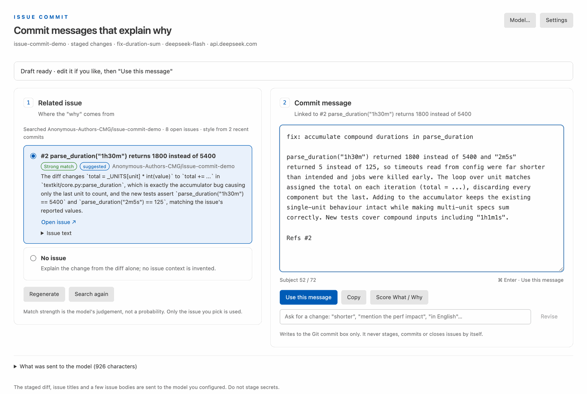

# Issue Commit

**Commit messages that explain *why*, not just *what*.**

Issue Commit reads your staged change, finds the open GitHub or GitLab issue it addresses, and writes a commit message that says what changed and why, grounded in that issue. You review it, tweak it, and it goes into the commit box. Nothing is committed for you.

[简体中文说明](https://github.com/Anonymous-Authors-CMG/CMG-Skills/blob/main/vscode/README.zh-CN.md)



## Why this exists

Ask any AI tool for a commit message and you get a neat summary of the diff:

```
fix: change total assignment to += in parse_duration
```

Correct, and useless six months later. Nobody can tell what broke, who hit it, or why this fix. That information sits in an issue nobody linked.

Issue Commit goes and gets it:

```
fix: accumulate compound durations in parse_duration

parse_duration("1h30m") returned 1800 instead of 5400 and "2m5s"
returned 5 instead of 125, so timeouts read from config were far shorter
than intended and jobs were killed early. The loop over unit matches
assigned the total on each iteration, discarding every component but
the last. Adding to the accumulator keeps single-unit specs working
while making multi-unit specs sum correctly.

Refs #2
```

The method comes from a study of 1,200 real commits across six projects (PyTorch, Keras, DeepSpeed, ClickHouse, Pulsar, RocketMQ). On a 0–4 scale, adding the linked issue lifted the *Why* score of generated messages from **2.55 to 3.93**. The correct issue was ranked first about 9 times in 10.

## Get started in a minute

1. **Install**, then run **Issue Commit: Set Up Model…** from the Command Palette.
   Pick GitHub Copilot (no key), or a provider and paste its API key. The wizard lists the provider's models and tests the connection.
2. **Stage** your changes.
3. Click **✨** in the Source Control title bar.

A few seconds later the panel shows the most likely issue, already selected if the match is strong, and a draft. Edit it if you like and click **Use this message** (or <kbd>⌘</kbd>/<kbd>Ctrl</kbd>+<kbd>Enter</kbd>).

Public repositories on github.com and gitlab.com need no further setup. For private repositories, see [Issue trackers](#issue-trackers).

## Features

**Finds the issue for you.** It reads issue *titles* first, in parallel batches, and only opens the bodies of the few that look right. That way a project with hundreds of open issues costs a handful of short requests. The list is cached for a few minutes, so running it again is quick.

**Explains why.** The draft covers the symptom, the root cause, and why this fix. It does not narrate the diff line by line, and it is told not to invent motivation that neither the diff nor the issue supports.

**One click, then review.** When the model is confident, the issue is pre-selected and the draft is written straight away. Pick another candidate or **No issue** and regenerate whenever you disagree.

**Says so when nothing fits.** Every candidate gets a strength (*strong*, *possible*, *weak*) and a one-line reason you can check. A refactor with no matching issue stays unlinked instead of being forced onto a lookalike.

**Revise in plain words.** Type "shorter", "mention the perf impact" or "in English" and click **Revise**.

**Uses your branch name.** On a branch like `fix/123-crash` or `issue-45`, that issue is always considered. Keys from other trackers such as `PROJ-123` are ignored.

**Matches your project's style.** A few recent commit messages from the repository are shown to the model as examples, so drafts follow your tone and length. Only messages are sent, never code.

**House rules.** Add instructions such as "scope must be one of api, ui, docs" in `issueCommit.message.instructions`. Put them in workspace settings and the whole team gets them.

**Score What / Why.** One click asks the model to rate the draft 0–4 on both axes, with a sentence on what would improve it. It's an opinion, not a test.

**Quick mode.** Prefer no panel? Run **Generate Commit Message (Quick, No Panel)**, or set `issueCommit.workflow.scmButton` to `quick`. You pick the issue from a short list and the message lands in the commit box.

**Safe defaults.**
- Never stages, commits, pushes or closes anything.
- References use `Refs #12` by default. `Fixes` closes the issue on merge, so you're asked to confirm each time.
- If the diff changes after the search, it refuses to fill in a stale message.
- Lock files, minified bundles and source maps are not sent.
- Keys and tokens live in VS Code Secret Storage, never in your project.

**Works with your model.** GitHub Copilot and other VS Code language models; OpenAI, DeepSeek, Qwen, Kimi, GLM, SiliconFlow, OpenRouter; Ollama and LM Studio on your machine; any OpenAI-compatible gateway.

**English and Chinese** UI. The message language follows VS Code unless you set it.

## Choosing a model

Run **Issue Commit: Set Up Model…** for a guided setup, or configure it by hand.

| Provider | `issueCommit.model.baseUrl` | Example `model.name` | Key |
|---|---|---|---|
| GitHub Copilot | – | – | none; set `model.provider` to `vscode-lm` |
| OpenAI | `https://api.openai.com/v1` | `gpt-4.1-mini` | [platform.openai.com](https://platform.openai.com/api-keys) |
| DeepSeek | `https://api.deepseek.com` | `deepseek-chat` | [platform.deepseek.com](https://platform.deepseek.com/api_keys) |
| Qwen (Alibaba Cloud) | `https://dashscope.aliyuncs.com/compatible-mode/v1` | `qwen-plus` | Model Studio console |
| Kimi (Moonshot) | `https://api.moonshot.cn/v1` | see the provider's list | Moonshot console |
| GLM (Zhipu) | `https://open.bigmodel.cn/api/paas/v4` | see the provider's list | Zhipu console |
| SiliconFlow | `https://api.siliconflow.cn/v1` | see the provider's list | SiliconFlow console |
| OpenRouter | `https://openrouter.ai/api/v1` | see the provider's list | [openrouter.ai](https://openrouter.ai/keys) |
| Ollama | `http://localhost:11434/v1` | `qwen2.5-coder`, `llama3.1` | none |
| LM Studio | `http://localhost:1234/v1` | the loaded model | none |
| Anything else | the URL before `/chat/completions` | – | if required |

Model names change often. The setup wizard reads the live list from the provider's `/models` endpoint, so pick from there when you can.

**Which model?** A small, fast model is enough. One message takes about 3–6 short requests: titles in batches, one read of a few issue bodies, one draft. With a cheap API model that's a fraction of a cent.

**Keys.** The wizard and **Set / Clear Model API Key…** store the key in Secret Storage, per API address. `issueCommit.model.token` also works for plain-text setups, is never synced, and wins if both are set.

**How the model is picked** (`issueCommit.model.provider`):
- `auto` (default): use the API if `model.baseUrl` is set, otherwise a VS Code language model such as Copilot.
- `openai-compatible`: always the API.
- `vscode-lm`: always a VS Code language model. `issueCommit.model.vscodeLm` picks one by id, `vendor/family` (e.g. `copilot/gpt-4o`) or family. Empty means the first Copilot model. VS Code asks once for permission.

## Issue trackers

Issue trackers are found from your Git remotes. `origin` counts as the home repository, so its issues are written as short `#12` references.

| Tracker | Setup |
|---|---|
| Public repo on github.com | none (60 API requests/hour without a token) |
| Private repo on github.com, or heavy use | a token via **Set Issue Platform Token…** → GitHub |
| gitlab.com | none for public projects; a token for private ones |
| GitHub Enterprise Server | add the repo to `issueCommit.issues.sources` with `"provider": "github"`, plus a token for its origin |
| Self-managed GitLab | add the project to `issueCommit.issues.sources` with `"provider": "gitlab"`, plus a token for its origin |
| Issues kept in a different repository | add it to `issueCommit.issues.sources` |

**Token permissions.** Read-only is enough:
- GitHub: a fine-grained token with *Issues: Read-only* on the repository; or a classic token with `repo` for private repositories.
- GitLab: a personal or project access token with `read_api`.

A token is only ever sent to the origin it was saved for.

**Configure Issue Search for This Project…** writes the per-project choices (auto-detect, extra sources, number of candidates) to the workspace settings. Tokens are never written there.

## Commands

| Command | What it does |
|---|---|
| **Generate Commit Message** | Opens the panel for the repository (the ✨ button) |
| **Generate Commit Message (Quick, No Panel)** | Search, pick the issue in a list, write the commit box |
| **Set Up Model…** | Guided model setup with a connection test |
| **Configure Issue Search for This Project…** | Turn search on/off, add sources, set how many candidates |
| **Set Issue Platform Token (GitHub/GitLab)…** | Save or remove a tracker token in Secret Storage |
| **Set / Clear Model API Key…** | Save or remove the key for the configured API address |
| **Check Connection** | Tests each issue tracker and the model, and writes the result to the *Issue Commit* output |
| **Open Settings** | All Issue Commit settings |
| **Get Started** | The walkthrough |

## Settings

All settings start with `issueCommit.`.

### Model

| Setting | Default | Description |
|---|---|---|
| `model.provider` | `auto` | `auto`, `openai-compatible` or `vscode-lm` (see above) |
| `model.baseUrl` | | API base URL. HTTPS, except on localhost |
| `model.name` | | Model name exactly as the provider spells it |
| `model.token` | | Plain-text key. Prefer Secret Storage. Machine-scoped, never synced |
| `model.vscodeLm` | | VS Code language model: id, `vendor/family` or family |
| `model.timeoutSeconds` | `120` | Per request, 10–600 |

### Issue search

| Setting | Default | Description |
|---|---|---|
| `issues.enabled` | `true` | Off = write from the diff only |
| `issues.autoDetect` | `true` | Find trackers from github.com / gitlab.com remotes |
| `issues.sources` | `[]` | Extra trackers: `[{ "url": "…", "provider": "github" \| "gitlab" }]` |
| `issues.autoSelect` | `high` | Pre-select the top issue on a `high` match, also on `medium`, or `never` |
| `issues.useBranchName` | `true` | Consider the issue number in the branch name |
| `issues.topN` | `3` | Candidates shown, 1–10 |
| `issues.poolSize` | `120` | Most recently updated open issues searched per tracker, 10–1000 |
| `issues.chunkSize` | `40` | Titles per first-stage request. Lower it if the right issue gets missed |
| `issues.maxBodyChars` | `8000` | Characters of each issue body read in the second stage |
| `issues.cacheMinutes` | `5` | Reuse the issue list this long. `0` = always refetch |
| `github.token` | | Plain-text token for github.com only |
| `gitlab.token` | | Plain-text token for gitlab.com only |
| `issues.tokensByOrigin` | `{}` | Plain-text tokens for self-hosted trackers, by exact origin |

### Message

| Setting | Default | Description |
|---|---|---|
| `message.language` | `auto` | `auto` (follow VS Code), `en`, `zh-CN` |
| `message.format` | `conventional` | `conventional` (`type: summary`) or `plain` |
| `message.trailer` | `refs` | `refs` (`Refs #12`), `fixes` (`Fixes #12`, closes on merge, confirmed each time), `none` |
| `message.instructions` | | House rules added to every request |
| `message.useHistory` | `true` | Use recent commit messages as style examples |
| `diff.maxChars` | `24000` | Longer diffs keep their first 70% and last 30% |

### Workflow

| Setting | Default | Description |
|---|---|---|
| `workflow.scmButton` | `panel` | What ✨ does: `panel` or `quick` |
| `workflow.autoGenerate` | `true` | Write the first draft as soon as the search finishes |
| `workflow.closeAfterApply` | `true` | Close the panel after **Use this message** |

### Example configurations

DeepSeek, set up by hand (the key goes in with **Set / Clear Model API Key…**):

```jsonc
// User settings
{
  "issueCommit.model.baseUrl": "https://api.deepseek.com",
  "issueCommit.model.name": "deepseek-chat"
}
```

GitHub Copilot only:

```jsonc
{
  "issueCommit.model.provider": "vscode-lm",
  "issueCommit.model.vscodeLm": "copilot/gpt-4o"
}
```

A team's shared rules, committed in `.vscode/settings.json`:

```jsonc
{
  "issueCommit.message.language": "en",
  "issueCommit.message.trailer": "fixes",
  "issueCommit.message.instructions": "Scope is one of: api, web, cli, docs. Mention breaking changes in the body.",
  "issueCommit.issues.sources": [
    { "url": "https://gitlab.example.com/platform/backend", "provider": "gitlab" }
  ]
}
```

A self-managed GitLab token, if you'd rather not use Secret Storage:

```jsonc
// User settings (machine-scoped, never synced)
{ "issueCommit.issues.tokensByOrigin": { "https://gitlab.example.com": "glpat-…" } }
```

No panel, straight to the commit box:

```jsonc
{ "issueCommit.workflow.scmButton": "quick" }
```

## What is sent where

- **To your model:** the staged diff (lock and minified files removed, at most `diff.maxChars`), the branch name, titles of open issues, the full text of a few candidates, the selected issue, and a few recent commit messages if `message.useHistory` is on. With Copilot, this goes through your Copilot subscription.
- **To GitHub / GitLab:** read-only requests for open issues.
- **Nothing else.** The extension makes no other network requests and collects no telemetry. Everything shown to the model is visible under *What was sent to the model* at the bottom of the panel.

Don't stage secrets. Untracked files are never read.

## Troubleshooting

Run **Issue Commit: Check Connection** first. It tests every tracker and the model and writes the results to the *Issue Commit* output channel without printing keys.

| Message | Fix |
|---|---|
| *No model is set up yet* | Run **Set Up Model…** |
| *HTTP 401 / 403* from the model | Wrong key, or the key can't use that model name |
| *HTTP 404* from the model | Check `model.baseUrl` (it should end before `/chat/completions`) and `model.name` |
| *Rate limit reached* from GitHub | Add a GitHub token |
| *HTTP 404* from GitHub/GitLab | Private repository without a token, or a wrong source URL |
| *Certificate verification failed* | Corporate proxy or CA; fix the system certificates instead of disabling checks |
| *The model did not return valid JSON* | Retry; small local models sometimes need a larger model |
| *The diff changed since the search* | You staged something new: click **Search again** |
| The wrong issue is suggested | Pick the right one or **No issue**; lower `issues.chunkSize`, or raise `issues.poolSize` for older issues |

## Also available

The same method as an agent skill for Claude Code, Codex, Cursor and other agents, and as a GitHub Action / GitLab CI bot that comments on pull requests: see [CMG-Skills](https://github.com/Anonymous-Authors-CMG/CMG-Skills).

## License

[MIT](https://github.com/Anonymous-Authors-CMG/CMG-Skills/blob/main/LICENSE)
