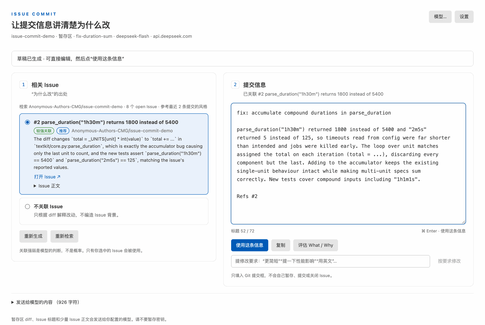

# Issue Commit

**让提交信息讲清楚“为什么改”，而不只是“改了什么”。**

Issue Commit 读取你暂存的改动，找到它对应的 GitHub 或 GitLab open Issue，再写出一条既说明改了什么、也说明为什么改的提交信息。你看一眼、改两句，它就填进提交框。插件不会替你提交。

[English](https://github.com/Anonymous-Authors-CMG/CMG-Skills/blob/main/vscode/README.md)



## 为什么做这个

让 AI 写提交信息，通常得到一句整齐的 diff 摘要：

```
fix: change total assignment to += in parse_duration
```

没写错。但半年后有人翻 `git log`，还是不知道当时什么坏了、谁碰到的、为什么这么修。这些都写在一个没人关联的 Issue 里。

Issue Commit 会去把它找出来：

```
fix: accumulate compound durations in parse_duration

parse_duration("1h30m") returned 1800 instead of 5400 and "2m5s"
returned 5 instead of 125, so timeouts read from config were far shorter
than intended and jobs were killed early. The loop over unit matches
assigned the total on each iteration, discarding every component but
the last. Adding to the accumulator keeps single-unit specs working
while making multi-unit specs sum correctly.

Refs #2
```

方法来自一项研究：在 PyTorch、Keras、DeepSpeed、ClickHouse、Pulsar、RocketMQ 六个项目的 1,200 个真实提交上，给模型补上关联 Issue 后，生成信息的“为什么”得分（0–4 分）从 **2.55 升到 3.93**。大约 10 次里有 9 次，正确的 Issue 排在第一。

## 一分钟上手

1. **安装**后，在命令面板运行 **Issue Commit: 配置模型…**。
   选 GitHub Copilot（不需要 Key），或选一个服务商、粘贴 API Key。向导会列出该服务商的模型，并测试一次连接。
2. **暂存**你的改动。
3. 点源代码管理标题栏上的 **✨**。

几秒后，面板会列出最可能相关的 Issue（关联足够强时已经帮你选好），并给出一份草稿。改到满意后点 **使用这条信息**（或按 <kbd>⌘</kbd>/<kbd>Ctrl</kbd>+<kbd>Enter</kbd>）。

github.com 和 gitlab.com 上的公开仓库不需要别的配置。私有仓库见 [Issue 平台](#issue-平台)。

## 功能

**自动找 Issue。** 先只看 Issue *标题*，分批并行扫描，再打开少数几个看起来对的 Issue 读正文。所以几百个 open Issue 的项目，也只需要几次很短的请求。Issue 列表会缓存几分钟，再跑一次很快。

**讲清楚为什么。** 草稿会写出现象、根因和为什么这样修，不会逐行复述 diff；diff 和 Issue 都没提到的动机，它被要求不要编。

**一键出草稿，你来把关。** 模型有把握时，会自动选中 Issue 并马上写草稿。不同意就换一个候选或选“不关联 Issue”，再生成一次。

**对不上就直说。** 每个候选都标了强弱（较强关联 / 可能相关 / 弱关联），附一句可以核对的理由。没有对应 Issue 的重构不会被硬套到一个长得像的 Issue 上。

**用一句话让它改。** 输入“更简短”“提一下性能影响”“用英文”，点 **按要求修改**。

**认得分支名。** 在 `fix/123-crash`、`issue-45` 这样的分支上，对应的 Issue 一定会被考虑。`PROJ-123` 这类其他系统的编号会被忽略。

**跟着项目的写法走。** 会把仓库最近几条提交信息给模型当参考，草稿的语气和长度更贴近你们的习惯。只发提交信息，不发代码。

**团队约定。** 在 `issueCommit.message.instructions` 里写上“scope 只能是 api、ui、docs”之类的规则。写在工作区设置里，整个团队都能用上。

**评估 What / Why。** 点一下，让模型从“改了什么”和“为什么改”两方面给草稿打 0–4 分，并说一句怎样能更好。这是模型的意见，不是测试结果。

**快速模式。** 不想开面板？运行 **快速生成提交信息（不打开面板）**，或把 `issueCommit.workflow.scmButton` 设成 `quick`。在一个短列表里选 Issue，提交信息直接写进提交框。

**默认就是安全的。**
- 不暂存、不提交、不推送，也不关闭任何东西。
- 默认用 `Refs #12` 引用。`Fixes` 会在合并后关闭 Issue，所以每次都会请你确认。
- 检索之后 diff 变了，就拒绝填入过时的信息。
- lock 文件、压缩后的打包文件和 source map 不会发送。
- Key 和 Token 存在 VS Code 安全存储里，不会写进项目。

**用你手上的模型。** GitHub Copilot 等 VS Code 语言模型；OpenAI、DeepSeek、通义千问、Kimi、智谱 GLM、硅基流动、OpenRouter；本机的 Ollama、LM Studio；以及任何 OpenAI 兼容网关。

**中英文界面。** 提交信息的语言默认跟随 VS Code，也可以单独设置。

## 选择模型

运行 **Issue Commit: 配置模型…** 跟着向导走，或者手动配置。

| 服务 | `issueCommit.model.baseUrl` | `model.name` 示例 | Key |
|---|---|---|---|
| GitHub Copilot | – | – | 不需要；把 `model.provider` 设为 `vscode-lm` |
| OpenAI | `https://api.openai.com/v1` | `gpt-4.1-mini` | [platform.openai.com](https://platform.openai.com/api-keys) |
| DeepSeek | `https://api.deepseek.com` | `deepseek-chat` | [platform.deepseek.com](https://platform.deepseek.com/api_keys) |
| 通义千问（阿里云百炼） | `https://dashscope.aliyuncs.com/compatible-mode/v1` | `qwen-plus` | 百炼控制台 |
| Kimi（月之暗面） | `https://api.moonshot.cn/v1` | 见服务商列表 | Moonshot 控制台 |
| 智谱 GLM | `https://open.bigmodel.cn/api/paas/v4` | 见服务商列表 | 智谱控制台 |
| 硅基流动 | `https://api.siliconflow.cn/v1` | 见服务商列表 | 硅基流动控制台 |
| OpenRouter | `https://openrouter.ai/api/v1` | 见服务商列表 | [openrouter.ai](https://openrouter.ai/keys) |
| Ollama | `http://localhost:11434/v1` | `qwen2.5-coder`、`llama3.1` | 不需要 |
| LM Studio | `http://localhost:1234/v1` | 已加载的模型 | 不需要 |
| 其他 | `/chat/completions` 之前的地址 | – | 视服务而定 |

模型名经常变。配置向导会从服务商的 `/models` 接口读取实时列表，能选就直接选。

**用什么模型？** 小而快的模型就够了。一条提交信息大约 3–6 次短请求：分批扫标题、读一次少量 Issue 正文、写一次草稿。用便宜的 API 模型，一次花不到一分钱。

**Key 存在哪。** 向导和 **设置 / 清除模型 API Key…** 会把 Key 存进安全存储，按 API 地址分开保存。也可以用明文的 `issueCommit.model.token`，它不会同步；两者都有时以它为准。

**怎么决定用哪个模型**（`issueCommit.model.provider`）：
- `auto`（默认）：填了 `model.baseUrl` 就用 API，否则用 Copilot 等 VS Code 语言模型。
- `openai-compatible`：总是用 API。
- `vscode-lm`：总是用 VS Code 语言模型。`issueCommit.model.vscodeLm` 可以按 id、`vendor/family`（如 `copilot/gpt-4o`）或 family 指定，留空则用第一个 Copilot 模型。第一次使用时 VS Code 会请你授权。

## Issue 平台

插件从 Git remote 自动找 Issue 区。`origin` 被当作本仓库，它的 Issue 会写成简短的 `#12`。

| 平台 | 需要做什么 |
|---|---|
| github.com 公开仓库 | 不用配置（不带 Token 每小时 60 次请求） |
| github.com 私有仓库，或用得很频繁 | 用 **设置 Issue 平台 Token…** → GitHub 添加 Token |
| gitlab.com | 公开项目不用配置；私有项目需要 Token |
| GitHub Enterprise Server | 在 `issueCommit.issues.sources` 里加上仓库，`"provider": "github"`，再为它的 origin 设 Token |
| 自建 GitLab | 在 `issueCommit.issues.sources` 里加上项目，`"provider": "gitlab"`，再为它的 origin 设 Token |
| Issue 放在另一个仓库 | 加进 `issueCommit.issues.sources` |

**Token 权限。** 只读就够：
- GitHub：fine-grained token，给目标仓库 *Issues: Read-only*；私有仓库也可以用带 `repo` 的 classic token。
- GitLab：带 `read_api` 的个人或项目访问令牌。

Token 只会发给保存时对应的那个 origin。

**配置当前项目的 Issue 检索…** 会把项目级的选择（是否自动发现、额外来源、候选个数）写进工作区设置。Token 永远不会写进去。

## 命令

| 命令 | 作用 |
|---|---|
| **生成提交信息** | 打开当前仓库的审阅面板（就是 ✨ 按钮） |
| **快速生成提交信息（不打开面板）** | 检索、在列表里选 Issue、写进提交框 |
| **配置模型…** | 向导式配置模型，并测试连接 |
| **配置当前项目的 Issue 检索…** | 开关检索、添加来源、设置候选个数 |
| **设置 Issue 平台 Token（GitHub/GitLab）…** | 在安全存储中保存或删除平台 Token |
| **设置 / 清除模型 API Key…** | 为当前 API 地址保存或删除 Key |
| **检查连接** | 逐个测试 Issue 平台和模型，结果写到“Issue Commit”输出面板 |
| **打开设置** | 打开全部 Issue Commit 设置 |
| **入门指引** | 打开入门引导 |

## 设置

所有设置都以 `issueCommit.` 开头。

### 模型

| 设置 | 默认值 | 说明 |
|---|---|---|
| `model.provider` | `auto` | `auto`、`openai-compatible` 或 `vscode-lm`（见上文） |
| `model.baseUrl` | | API 根地址。除 localhost 外必须 HTTPS |
| `model.name` | | 模型名，与服务商写法一致 |
| `model.token` | | 明文 Key。建议改用安全存储。仅本机、不同步 |
| `model.vscodeLm` | | VS Code 语言模型：id、`vendor/family` 或 family |
| `model.timeoutSeconds` | `120` | 单次请求超时，10–600 秒 |

### Issue 检索

| 设置 | 默认值 | 说明 |
|---|---|---|
| `issues.enabled` | `true` | 关闭后只根据 diff 生成 |
| `issues.autoDetect` | `true` | 从 github.com / gitlab.com 的 remote 自动发现 Issue 区 |
| `issues.sources` | `[]` | 额外的 Issue 区：`[{ "url": "…", "provider": "github" \| "gitlab" }]` |
| `issues.autoSelect` | `high` | 较强关联时自动选中第一名；`medium` 时可能相关也选；`never` 从不 |
| `issues.useBranchName` | `true` | 把分支名里的 Issue 编号作为候选 |
| `issues.topN` | `3` | 展示的候选个数，1–10 |
| `issues.poolSize` | `120` | 每个 Issue 区检索的最近更新 open Issue 数，10–1000 |
| `issues.chunkSize` | `40` | 第一阶段每次请求的标题数。正确的 Issue 常被漏掉时调小 |
| `issues.maxBodyChars` | `8000` | 第二阶段每个 Issue 正文读取的字符数 |
| `issues.cacheMinutes` | `5` | Issue 列表缓存分钟数。`0` 表示每次都重新读取 |
| `github.token` | | 明文 Token，只用于 github.com |
| `gitlab.token` | | 明文 Token，只用于 gitlab.com |
| `issues.tokensByOrigin` | `{}` | 自建平台的明文 Token，按 origin 精确匹配 |

### 提交信息

| 设置 | 默认值 | 说明 |
|---|---|---|
| `message.language` | `auto` | `auto`（跟随 VS Code）、`en`、`zh-CN` |
| `message.format` | `conventional` | `conventional`（`type: 摘要`）或 `plain` |
| `message.trailer` | `refs` | `refs`（`Refs #12`）、`fixes`（`Fixes #12`，合并后关闭，每次确认）、`none` |
| `message.instructions` | | 附加到每次请求的团队约定 |
| `message.useHistory` | `true` | 用最近的提交信息作为风格参考 |
| `diff.maxChars` | `24000` | 超长 diff 保留开头 70% 和结尾 30% |

### 工作流程

| 设置 | 默认值 | 说明 |
|---|---|---|
| `workflow.scmButton` | `panel` | ✨ 按钮的行为：`panel` 或 `quick` |
| `workflow.autoGenerate` | `true` | 检索完成后马上写第一版草稿 |
| `workflow.closeAfterApply` | `true` | 点 **使用这条信息** 后关闭面板 |

### 配置示例

手动配置 DeepSeek（Key 用 **设置 / 清除模型 API Key…** 存）：

```jsonc
// 用户设置
{
  "issueCommit.model.baseUrl": "https://api.deepseek.com",
  "issueCommit.model.name": "deepseek-chat"
}
```

只用 GitHub Copilot：

```jsonc
{
  "issueCommit.model.provider": "vscode-lm",
  "issueCommit.model.vscodeLm": "copilot/gpt-4o"
}
```

团队共享的约定，提交在 `.vscode/settings.json` 里：

```jsonc
{
  "issueCommit.message.language": "zh-CN",
  "issueCommit.message.trailer": "fixes",
  "issueCommit.message.instructions": "scope 只能是 api、web、cli、docs。有破坏性变更时在正文里写明。",
  "issueCommit.issues.sources": [
    { "url": "https://gitlab.example.com/platform/backend", "provider": "gitlab" }
  ]
}
```

自建 GitLab 的 Token，如果不想用安全存储：

```jsonc
// 用户设置（仅本机，不同步）
{ "issueCommit.issues.tokensByOrigin": { "https://gitlab.example.com": "glpat-…" } }
```

不开面板，直接写进提交框：

```jsonc
{ "issueCommit.workflow.scmButton": "quick" }
```

## 哪些数据发到哪里

- **发给你配置的模型：** 暂存区 diff（去掉 lock 和压缩文件，最多 `diff.maxChars` 字符）、分支名、open Issue 的标题、少数候选的全文、选中的 Issue，以及开启 `message.useHistory` 时的几条最近提交信息。用 Copilot 时，这些通过你的 Copilot 订阅发送。
- **发给 GitHub / GitLab：** 读取 open Issue 的只读请求。
- **没有别的了。** 插件不发其他网络请求，也不收集任何统计数据。发给模型的内容都能在面板底部“发送给模型的内容”里看到。

请不要暂存密钥。未跟踪的文件不会被读取。

## 遇到问题

先运行 **Issue Commit: 检查连接**。它会逐个测试 Issue 平台和模型，把结果写到“Issue Commit”输出面板，不会打印任何 Key。

| 提示 | 怎么办 |
|---|---|
| *还没配置模型* | 运行 **配置模型…** |
| 模型返回 *HTTP 401 / 403* | Key 不对，或这个 Key 不能用该模型名 |
| 模型返回 *HTTP 404* | 检查 `model.baseUrl`（写到 `/chat/completions` 之前为止）和 `model.name` |
| GitHub 提示 *已达到访问频率上限* | 添加 GitHub Token |
| GitHub/GitLab 返回 *HTTP 404* | 私有仓库没配 Token，或来源地址写错 |
| *证书校验失败* | 公司代理或 CA 的问题；请修好系统证书，不要关闭校验 |
| *模型没有返回有效 JSON* | 重试；本地小模型有时需要换个大一点的 |
| *检索之后 diff 有变化* | 你又暂存了新内容，点 **重新检索** |
| 推荐的 Issue 不对 | 手动选对的或选“不关联 Issue”；调小 `issues.chunkSize`；要找较早的 Issue 就调大 `issues.poolSize` |

## 其他形态

同样的方法也做成了 Claude Code、Codex、Cursor 等 Agent 可用的 skill，以及在 PR 下发评论的 GitHub Action / GitLab CI 机器人，见 [CMG-Skills](https://github.com/Anonymous-Authors-CMG/CMG-Skills)。

## 许可证

[MIT](https://github.com/Anonymous-Authors-CMG/CMG-Skills/blob/main/LICENSE)
